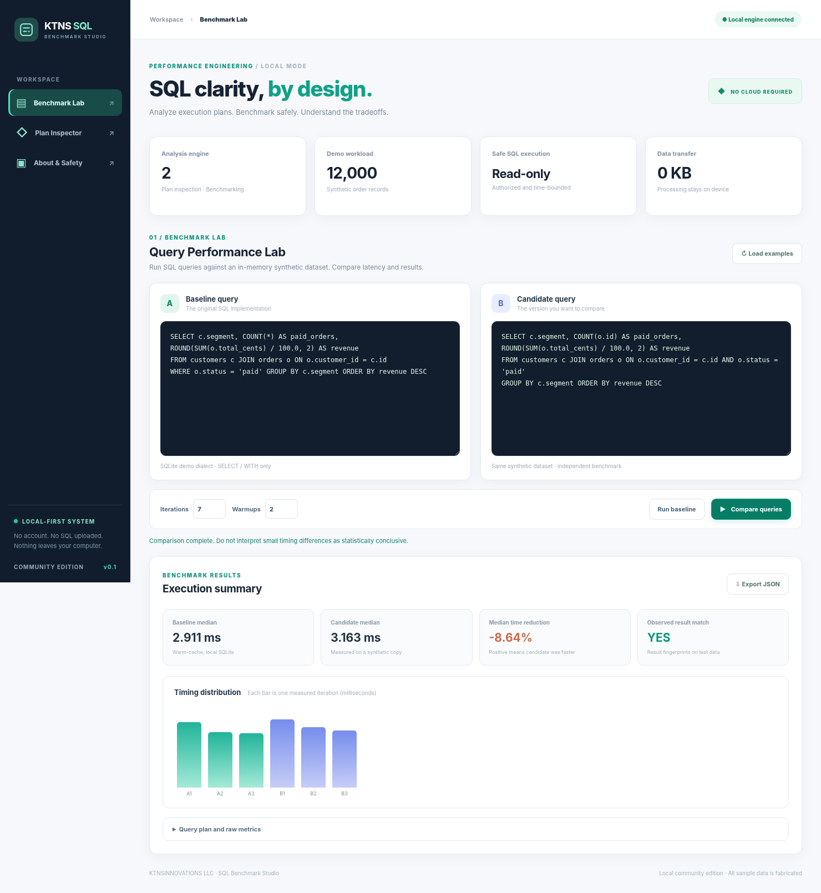
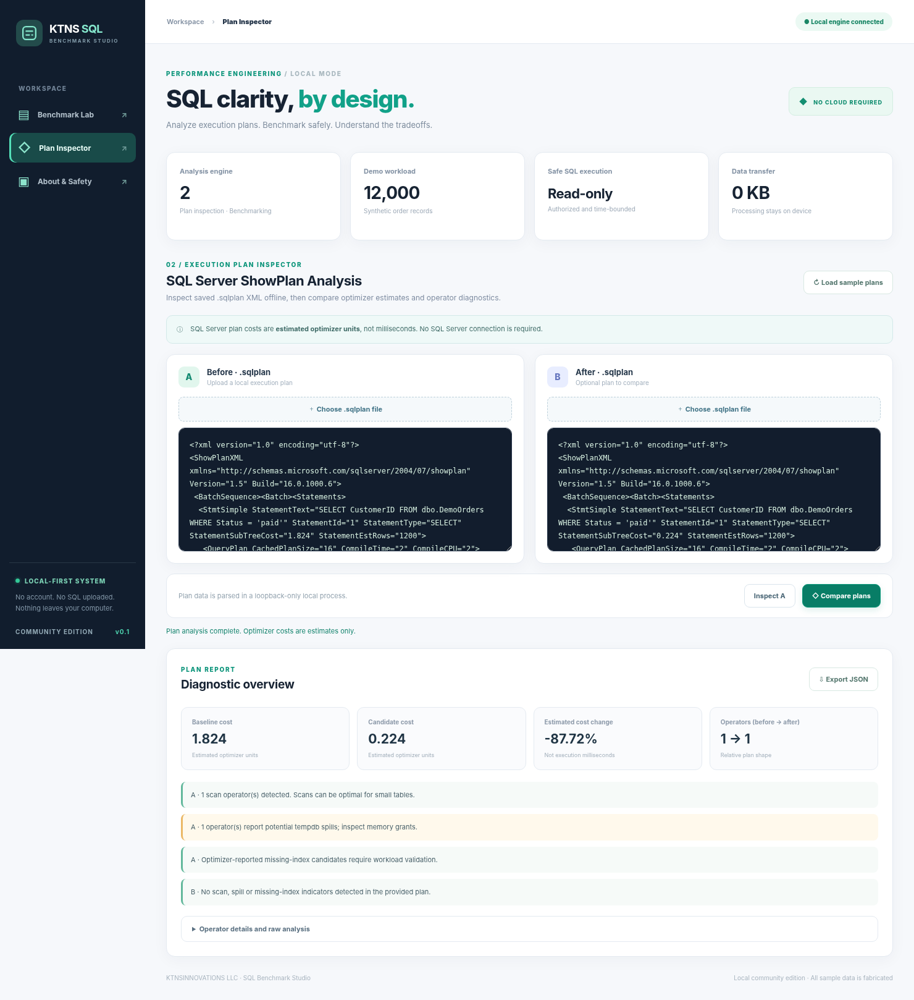

# KTNS SQL Benchmark Studio

[](https://github.com/tayyadev/sql-query-benchmark-studio/actions/workflows/ci.yml)

**Local-first SQL Server plan analysis and reproducible read-only SQL benchmarking.**

A complete, original engineering portfolio project with an offline browser interface, a command-line interface, realistic synthetic datasets, defensive query execution and automated tests. No accounts, API keys, hosted service or required third-party Python packages.

> **Scope clarification:** This community edition reads **SQL Server ShowPlan `.sqlplan` XML offline** and benchmarks **SQLite SELECT queries** against synthetic local data. It does *not* run live benchmarks on SQL Server, connect to SQL Server, recommend executable index DDL, provide hosted monitoring, or include paid licensing. Optimizer costs are not observed query runtimes. It is not a replacement for a commercial database APM solution.

## Screenshots





The screenshots show synthetic examples, not customer workloads or verified production speedups.

## Features implemented

| Area | Features |
|---|---|
| Plan inspector | Parse SQL Server ShowPlan XML, inspect operator types and estimated subtree costs, actual row counters where supplied, missing-index hints, scan and spill indicators |
| Plan comparison | Compare estimated statement costs and operator counts; validate statement identity using hashes |
| Read-only benchmark | Compare SQLite queries A and B, result fingerprints, multiple iterations, warmups, median, p95 and min/max latencies |
| Safety | Explicit read-only SQLite authorizer, query execution deadlines, resource ceilings, row limits, no file access via browser API, local-only server, JSON payload limits |
| Reports | Offline JSON export from UI and CLI; no raw SQL statement literals returned by plan API |
| Usability | Zero-dependency Python runtime, modern responsive UI, synthetic built-in examples, CLI, Windows packaging recipe |
| Quality | Unit/API regression tests, browser-interface smoke check, Linux/Windows CI setup |

## Quick start: Windows, Linux or macOS

Requires **Python 3.11+**.

```powershell
# Open terminal in this repository
python -m sqlbench serve
```

Open **http://127.0.0.1:8765**. Nothing is deployed to the Internet.

If using a different port:

```powershell
python -m sqlbench serve --port 8866
```

There is nothing to install unless you want the optional command `sqlbench` on PATH. This command is equivalent:

```bash
python -m pip install -e .
sqlbench serve
```

> For Windows users without Python installed, see [Windows packaging](docs/WINDOWS_RELEASE.md). Public source is available immediately; no compiled executable is included in this repository.

## Examples: offline SQL Server execution plans

In SQL Server Management Studio, save an estimated or actual **SQL Server `.sqlplan` XML** file from a database you are authorized to inspect. Prefer a sanitized plan if statements contain sensitive literals. Then use the **Plan Inspector** tab or CLI:

```bash
python -m sqlbench plan examples/sample-scan.sqlplan
python -m sqlbench compare-plans examples/sample-scan.sqlplan examples/sample-seek.sqlplan
```

The sample plans are **synthetic illustrative XML fixtures**. They are not performance proof on a real SQL Server installation.

The parser reports estimated optimizer costs, counts operators such as `Index Seek` and `Table Scan`, identifies plan spill indicators and reports optimizer missing-index suggestions. These are diagnostic hints requiring review, **not** instructions to apply indexes automatically.

## Examples: read-only SQL benchmarks

Run against the built-in, deterministic database of 2,000 synthetic customers and 12,000 synthetic orders:

```bash
python -m sqlbench benchmark examples/before.sql --iterations 7 --warmups 2
python -m sqlbench compare-sql examples/before.sql examples/after.sql --iterations 7
```

The browser UI's **Benchmark Lab** also loads these examples automatically. It compares the observed rows using an order-independent fingerprint, runs warmups, reports p50/p95 and displays iteration-level charts. The default dataset is recreated in-memory on each request and discarded afterward.

For a **trusted local SQLite file selected by the user**, the CLI can open that file read-only:

```bash
python -m sqlbench benchmark examples/before.sql --database /path/to/your/test.db
```

The example query expects the synthetic schema; supply your own query file for your own SQLite schema. The browser API **never** accepts local database file paths. Even with read-only safeguards, use anonymized **test databases** rather than production databases.

**Important:** This engine benchmarks SQLite. SQLite execution plans and timings cannot be interpreted as SQL Server execution timings. It has no remote database connectivity.

## Advanced SQL examples for technical interviews

The independently written, automatically tested [SQL pattern library](examples/patterns/) includes:

- **Top N per group** using `ROW_NUMBER()` and partitioning.
- **Running revenue** using windowed `SUM` with explicit frame boundaries.
- **Recursive calendar** generation with a bounded CTE.
- **Anti-join** using `NOT EXISTS`.
- **Gaps and islands** using `ROW_NUMBER()` to group consecutive days.
- **Day-over-day trends** with `LAG`.

The examples run against the synthetic SQLite schema and have correctness assertions. The general ideas also apply to SQL Server, but dialect details differ; these particular fixtures are **not** validated T-SQL scripts.

## REST API (local only)

All endpoints are served on `127.0.0.1`. Mutating HTTP requests never change customer data; they run bounded analysis jobs. POST requests require `Content-Type: application/json` and `X-SqlBench-Request: 1`.

| HTTP | Route | Payload |
|---|---|---|
| GET | `/api/health` | None |
| GET | `/api/demo` | None; returns fabricated sample SQL and plans |
| POST | `/api/plan` | `{ "xml": "<ShowPlanXML...>" }` |
| POST | `/api/plan/compare` | `{ "before": "...", "after": "..." }` |
| POST | `/api/benchmark` | `{ "sql": "SELECT...", "iterations": 7, "warmups": 2 }` |
| POST | `/api/benchmark/compare` | `{ "before": "SELECT...", "after": "SELECT...", "iterations": 7 }` |

Example:

```bash
curl -X POST http://127.0.0.1:8765/api/benchmark \
  -H 'Content-Type: application/json' \
  -H 'X-SqlBench-Request: 1' \
  -d '{"sql":"SELECT COUNT(*) FROM orders", "iterations": 5, "warmups": 1}'
```

`/api/plan` accepts up to 2 MiB of XML. Results include machine-readable diagnostics and caveats.

## Testing and reproducibility

```bash
python -m unittest discover -s tests -v
python -m compileall -q sqlbench
node --check web/app.js # optional: Node.js syntax check
```

CI targets Python 3.11 and 3.12 across Windows and Ubuntu. See [architecture](docs/ARCHITECTURE.md), [security policy](SECURITY.md), and [Windows release](docs/WINDOWS_RELEASE.md).

## Repository map

```text
sqlbench/              Safe core engines, local API and CLI
web/                   Responsive offline HTML, CSS and JavaScript
examples/              Fully synthetic SQL, advanced SQL patterns and .sqlplan fixtures
tests/                 Deterministic unit and local HTTP API tests
docs/                  Architecture, screenshots and packaging guide
.github/workflows/     Cross-platform Python CI
```

## Product and licensing approach

The public community project uses the **MIT license** and may be freely used under that license. A future private desktop Pro edition could offer advanced report templates, scheduled checks, and other *separately developed* value, with a potential launch price of **$19 once**. Ongoing monitoring and collaboration features could later justify a separate **$9/month** service. **Neither commercial edition nor licensing is implemented here**, and no sales demand is guaranteed. See [commercial roadmap](docs/COMMERCIAL.md).

## Independence and confidentiality

Everything in this public repository is independently written for this example. No private repository contents, customer data, proprietary SQL or API keys are used. The application does not include or reference any private licensing endpoint.

## License

MIT License. Copyright (c) 2026 KTNSINNOVATIONS LLC.
